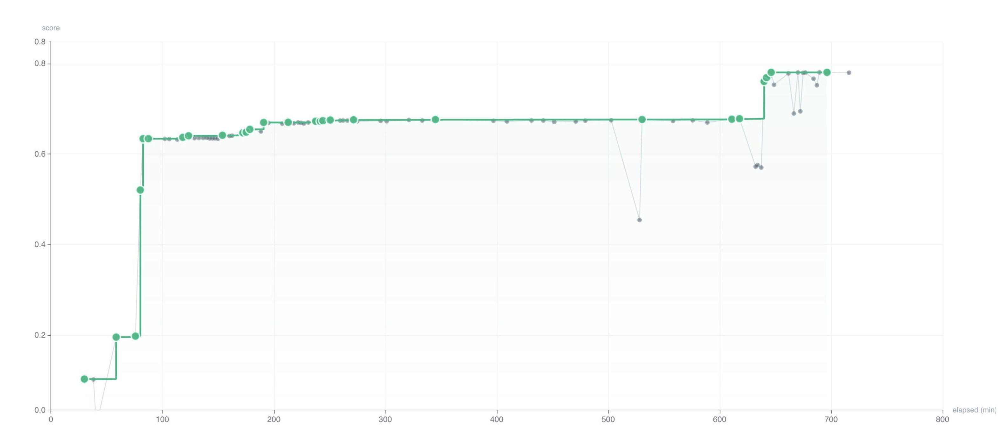
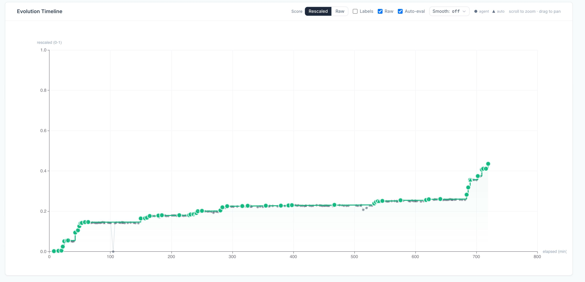
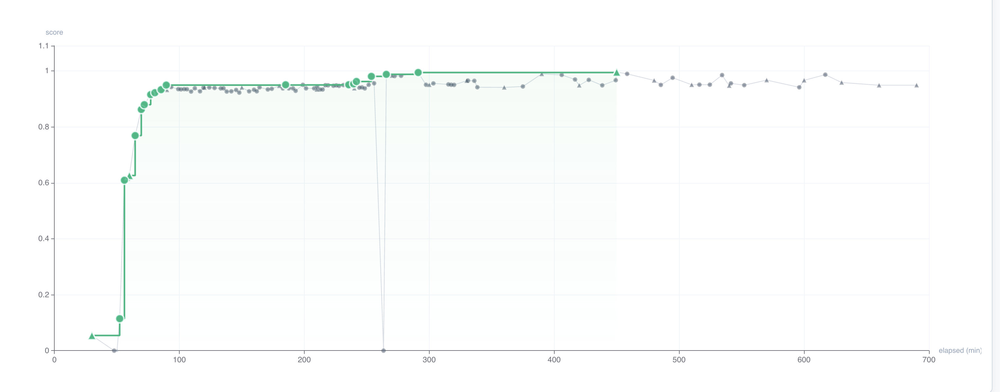
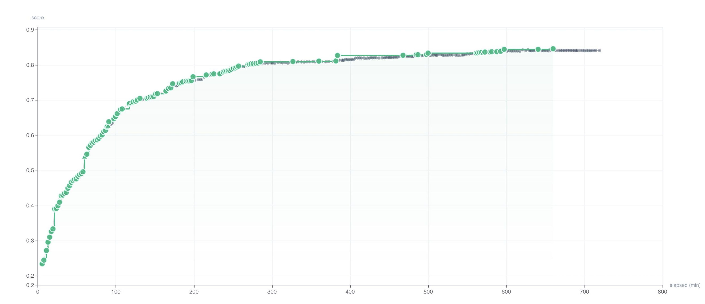
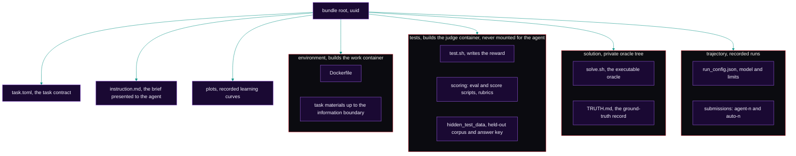
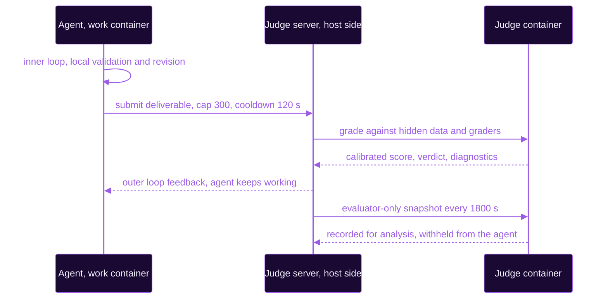

<p align="center"></p>

<p align="center"><strong>Two long-horizon RL environments in systems and software engineering. Measured by a judge the agent never sees.</strong></p>

<p align="center"><a href="#contact"></a> <a href="#dataset-structure"></a> <a href="#summary"></a>

<p align="center"><sub><a href="#abstract">Abstract</a> &middot; <a href="#why-this-is-hard">Why this is hard</a> &middot; <a href="#difficulty">Difficulty</a> &middot; <a href="#task-catalog">Task catalog</a> &middot; <a href="#dataset-structure">Dataset structure</a> &middot; <a href="#reproduction">Reproduction</a></sub></p>

# Mephisto: Long-Horizon RL Environments

## Abstract

Mephisto publishes two reinforcement learning environments inside one capability family, Systems & Software Engineering: production-grade code where an agent has to satisfy a correctness target and a performance target at the same time, across interdependent modules, at a scale no single edit resolves. Both demand behavioral re-implementation of a production library. One rebuilds libpcap 1.10.6's packet filter compiler and is graded on exact bytecode and exact error-string equality; the other rebuilds FFmpeg's libswscale and is graded through an absolute correctness gate and then on measured speedup. Each is a containerized workspace with a twelve hour interaction window, a continuous reward in `[0, 1]`, and a separate judge container holding evaluation assets the agent never sees. Each measures whether an agent improves across a long episode under repeated graded feedback, rather than whether it produces one correct endpoint answer. This release carries the structural contract that holds across Mephisto families: the two-container work-and-judge split, the multi-round delivery feedback protocol, and the full recorded submission history that makes an in-episode learning curve legible, here across three recorded runs and two frontier models.

## Why this is hard

**Exactness.** Take `62b54382-a910-5b29-ad0e-1efa993cc615`, libpcap BPF Codegen Fidelity. The task is to rebuild libpcap 1.10.6's packet filter compiler in C from observable behavior alone, with no libpcap source, header, binary, documentation, or network available. The graded surface is exactness: for each of 12,000 hidden `(dlt, snaplen, optimize, netmask, filter)` cases the program must emit either the exact classic-BPF instruction tuple sequence libpcap 1.10.6 produces, or the exact error string it produces on rejection. A program that accepts and rejects the same packets as the reference but differs by one instruction, one jump offset, one immediate value, or one word of an error message is wrong at the graded surface. Recalling what a BPF program for a filter "should" look like is the most reliable way to fail; the graded value is what libpcap 1.10.6 *actually emitted*, recovered by excavation from a 2,000-case public corpus generated from a disjoint seed at identical stratum proportions. Copying upstream source (even renamed, reflowed, or reconstructed from memory) is detected by normalized 5-gram containment and hard-zeroes the submission; linking `-lpcap` or shelling out is detected by `nm -D`/`ldd` and hard-zeroes it too.

**Performance.** Take `f6424bd2-3d99-5647-9f59-6323ace5d907`, FFmpeg swscale Reimplementation. This task inverts the information boundary, and the inversion is the point: FFmpeg's scalar C source and a full reference binary are both inside the work container, and neither one wins the task. The deliverable is a C-ABI shared library, written in Rust or Zig, that converts between any pair of ten pixel formats (planar and semi-planar YUV, packed RGB and BGR with and without alpha, grayscale) under three scaling algorithms, and the graded quantity is the geometric mean of `baseline_time / candidate_time` over hidden workloads against an FFmpeg C-scalar baseline built and timed on the same machine. Reading the reference tells the solver what to compute and nothing about how to beat it; inline assembly is forbidden, so every point of speed has to come from portable SIMD and from the memory behavior the solver designs around it. The work container is `linux/arm64`; the available SIMD ISA is NEON and SVE, not x86 intrinsics. The correctness gate is absolute and is applied first: PSNR ≥ 60 dB per plane on same-size format conversion, exact bytes on mathematically lossless paths such as an RGB↔BGR channel swap, PSNR ≥ 40 dB per plane once scaling is involved, and one hidden workload below its threshold zeroes the submission no matter how fast the rest of it runs. Wrapping the reference is closed off from both ends: the verifier rebuilds the library from source and rejects pre-built binaries, and the reference binary is deleted before scoring, so a library that dlopens it fails rather than cheats.

## Difficulty

Difficulty is read off measured frontier reward across 12-hour runs rather than asserted. Every recorded run in this release reports `timed_out: true` at 43200 s, so the scores below are the best reached inside the window, not converged ceilings.

| Bundle | Recorded run | Agent and model | Best score | Best round | Rounds |
| --- | --- | --- | --- | --- | --- |
| `62b54382` libpcap bpf codegen fidelity | `opus-5` | `claude-code`, `claude-opus-5[1m]` | 0.9956 | `auto-15` | 113 |
| `62b54382` libpcap bpf codegen fidelity | `gpt-5.6-sol` | `codex`, `gpt-5.6-sol` | 0.8464 | `agent-252` | 299 |
| `f6424bd2` ffmpeg swscale reimplementation | `opus-5` | `claude-code`, `claude-opus-5[1m]` | 0.7805 | `agent-88` | 112 |
| `f6424bd2` ffmpeg swscale reimplementation | `gpt-5.6-sol` | `codex`, `gpt-5.6-sol` | 0.4355 | `agent-218` | 241 |

The two reward geometries, exact-match conformance and correctness-gated speedup, are described in [Scoring methodology](#scoring-methodology) and are not commensurable with each other. They are reported per bundle rather than folded into one difficulty index. Because the libpcap bundle carries two recorded runs on the same graded surface, it also shows two different shapes of the same 12 hours.

<p align="center"><sub><strong>FFmpeg swscale Reimplementation &middot; run: opus-5 &middot; claude-code / claude-opus-5[1m] &middot; best score: 0.7805</strong></sub></p>

<p align="center"></p>

<p align="center"><sub><strong>FFmpeg swscale Reimplementation &middot; run: gpt-5.6-sol &middot; codex / gpt-5.6-sol &middot; best score: 0.4355</strong></sub></p>

<p align="center"></p>

<p align="center"><sub><strong>libpcap BPF Codegen Fidelity &middot; run: opus-5 &middot; claude-code / claude-opus-5[1m] &middot; best score: 0.9956</strong></sub></p>

<p align="center"></p>

<p align="center"><sub><strong>libpcap BPF Codegen Fidelity &middot; run: gpt-5.6-sol &middot; codex / gpt-5.6-sol &middot; best score: 0.8464</strong></sub></p>

<p align="center"></p>

Same task, same budget, different dynamics: on libpcap the Opus 5 run takes most of its score in a staircase inside the first 90 minutes and spends the rest of the window buying the last few points of exactness, while the GPT-5.6 run climbs smoothly and flattens near 0.84. The swscale run holds a plateau near 0.67 through the middle of the run before a late break to 0.7805 past the tenth hour; its best submission cleared correctness on 30 of 30 hidden workloads at a raw geometric-mean speedup of 122.77x over the same-machine C-scalar baseline. That raw speedup is mapped onto the `[0, 1]` scale through a log anchor inherited from the x86 touchstone. The ARM recalibration of that anchor is still pending and is recorded as such in `task.toml`; the mapping is monotonic, so it relabels rather than reorders, and the raw speedup is retained in `reward.json`.

## Task catalog

Two self-contained bundles, addressed by UUID at the repository root, in one family.

### Systems & Software Engineering

| Bundle | Task | Deliverable surface | Graded against | Toolchain |
| --- | --- | --- | --- | --- |
| `62b54382` | `libpcap_bpf_codegen_fidelity` | C11 rebuild of the libpcap 1.10.6 BPF compiler (`src/`, `include/`, `Makefile`) | Exact cBPF tuple + exact error-string equality over 12,000 hidden cases, 8 weighted strata, plus a gated throughput term | C (`cpp` base), `linux/amd64` |
| `f6424bd2` | `ffmpeg_swscale_reimplementation` | C-ABI shared library re-implementing FFmpeg libswscale (scaling + pixel-format conversion) in Rust or Zig | PSNR-gated correctness (≥60 dB format-only, ≥40 dB scaling) then geometric-mean speedup vs a same-machine C-scalar baseline | Rust/Zig (`rust` base), `linux/arm64` |

The two bundles split the family along its two grading axes. Fidelity is graded where the reference behavior is withheld and the answer must be excavated from observation; performance is graded where the reference is fully visible and the only thing left to win is measured speed. The swscale bundle is an ARM64-native rebuild, so it runs on Graviton and Apple Silicon hosts without emulation.

## Contributions

- A two-container work and judge split, where the work container holds task materials and local validation tools and no hidden evaluation asset, and a host-side judge server mediates submission queues, cooldowns, authentication and asynchronous grading. To our knowledge no reviewed agent benchmark documents this architecture; [SWE-bench](https://arxiv.org/abs/2310.06770), [SWE-Lancer](https://arxiv.org/abs/2502.12115) and [MLE-bench](https://arxiv.org/abs/2410.07095) hide assets inside the same sandbox, and MLE-bench co-locates a validation server the agent can query.
- Multi-round delivery feedback that approximates a real review cycle. OpenAI's own [GDPval](https://arxiv.org/abs/2510.04374) writeup states that the current version does not go through multiple drafts, and the [Remote Labor Index](https://arxiv.org/abs/2510.26787) excludes work requiring direct client interaction by design.
- A full recorded submission history, agent-initiated and evaluator-only, retained so that an in-episode learning curve is recoverable after the run, and published here for two different frontier agents on the same graded surface. Trajectory logging elsewhere targets efficiency analysis rather than learning measurement.
- A primary per-task continuous scalar in `[0, 1]`, held constant across two very different reward geometries: exact-match conformance with a gated throughput term, and an absolute correctness gate followed by measured speedup. Partial credit exists elsewhere, so the narrow claim is that the continuous score is the primary signal, not a secondary one.
- Depth inside a named engineering vertical rather than first coverage of it. Software engineering is already well covered by [SWE-bench Verified](https://openai.com/index/introducing-swe-bench-verified/) and [SWE-Lancer](https://arxiv.org/abs/2502.12115); what is added here is a day-scale horizon over a re-implementation surface where recall of the upstream answer is explicitly detected and penalized.

## Summary

The shared contract is listed first; the properties that differ between the two bundles follow.

| Property | Value |
| --- | --- |
| Task bundles in this release | 2 (both Systems & Software Engineering) |
| Agent interaction window | 43200 s (12 h) per task |
| Verifier environment mode | `separate` container |
| Network | `no-network` on both work and judge containers (both bundles) |
| Reward | continuous, primary scalar in `[0, 1]` |
| Submission cap | 300 per episode, 120 s cooldown |
| Evaluator-only snapshot interval | 1800 s |
| Underlying material | observable behavior of public production libraries (libpcap 1.10.6, FFmpeg libswscale) |
| Release license | CC BY-NC-ND 4.0 |

Bundle-specific properties:

| Property | libpcap (`62b54382`) | ffmpeg (`f6424bd2`) |
| --- | --- | --- |
| Base image | `cpp` | `rust` |
| Platform | `linux/amd64` | `linux/arm64` |
| Verifier timeout | 900 s | 5400 s |
| Result parser | `structured_json` | `pytest_v` |
| Reward composition | `0.88·C + 0.12·P` conformance with gated throughput | correctness gate → geometric-mean speedup |
| Reference availability | source, headers, binary and docs all withheld | scalar C source and reference binary provided, deleted before scoring |
| Recorded runs | `opus-5`, `gpt-5.6-sol` | `opus-5` |

## Related work

| Benchmark | Publisher and date | Tasks | Agent episode budget | Reward signal | Judge isolation | Multi-round revision |
| --- | --- | --- | --- | --- | --- | --- |
| [GDPval](https://arxiv.org/abs/2510.04374) | OpenAI, 2025-10 | 1320, 220 open | not stated | human pairwise win, tie, loss | gold files open-sourced | no, stated as future work |
| [Agents' Last Exam](https://arxiv.org/abs/2606.05405) | UC Berkeley RDI, 2026-06 | ~1490, ~152 public | hours to weeks | milestone pass or fail scripts | hidden references, container split unconfirmed | no |
| [Remote Labor Index](https://arxiv.org/abs/2510.26787) | Scale AI and CAIS, 2025-10 | 240, 10 public | not stated | 3 point human scale, Elo secondary | manual expert review only | excluded by design |
| [SWE-Lancer](https://arxiv.org/abs/2502.12115) | OpenAI, 2025-02 | 1488, 502 public | 3 h, pass at 1 | binary end to end tests | hidden tests, same sandbox | no |
| [MLE-bench](https://arxiv.org/abs/2410.07095) | OpenAI, 2024-10 | 75 competitions | up to 24 h | medal threshold, percentile underneath | validation server inside agent container | no |
| [TheAgentCompany](https://arxiv.org/abs/2412.14161) | CMU, 2024-12 | 175 | ~27 steps | partial credit checkpoints | not architecturally separated | no |
| [OSWorld 2.0](https://arxiv.org/abs/2606.29537) | multi-institution, 2026-06 | 108 workflows | ~318 tool calls | binary plus continuous partial | environment state check | no |
| [SWE-bench Verified](https://openai.com/index/introducing-swe-bench-verified/) | OpenAI, 2024-08 | 500 | single patch | binary hidden unit tests | hidden tests, same sandbox | no |

The 12 hour window is not the longest agent budget on this table, since MLE-bench grants 24 hours. The differentiating axes are the last two columns.

## Dataset structure

One self-contained bundle per task, addressed by UUID at the repository root. The work container and the judge container are built from disjoint subtrees, and nothing under `tests/` or `solution/` is ever mounted for the agent.



Both bundles carry the starter implementation directly under `environment/`, up to the information boundary the task defines. The libpcap bundle ships a C source tree with `src/`, `include/` and a `Makefile`, the 2,000-case public corpus as `public_cases.jsonl`, and a local `score.sh` the agent can run against it; the graded corpus, the upstream source and the upstream binary are absent. The swscale bundle ships Rust and Zig scaffolds, the C API header, the public C-scalar baseline library, generated media fixtures, and the local `verify_correctness.py` and `run_dev_bench.py` tools; the hidden workloads live only in the judge tree. `solution/TRUTH.md` is the ground-truth record: a human-readable statement of the route through `instruction.md` that satisfies every checker. It never crosses into the agent-visible bundle. Each bundle also carries `plots/`, one recorded learning curve per run.

## Trajectory structure

The protocol runs two loops. The inner loop is local and agent-driven, with a writable workspace, local validation and unlimited revision. The outer loop is judge-mediated, evaluating a submitted deliverable against hidden data and graders, and returning a calibrated score, a verdict and diagnostics. A third channel records evaluator-only snapshots on a fixed 1800 s interval through the same hidden judge; those are retained for analysis and never shown to the agent.



For libpcap the outer-loop feedback is deliberately coarse: between attempts the agent receives stratum-level aggregate counts and nothing else, never a per-case diff, never the identity or stratum membership of a hidden case. The channel is too narrow to binary-search the graded corpus.

The recorded submission counts below are properties of the published tree rather than statements about capability. Runs are published under `trajectory/<run>/`; the libpcap bundle carries two.

| Bundle | Recorded run | Agent-initiated | Evaluator-only | Total |
| --- | --- | --- | --- | --- |
| `62b54382` libpcap bpf codegen fidelity | `gpt-5.6-sol` | 276 | 23 | 299 |
| `62b54382` libpcap bpf codegen fidelity | `opus-5` | 90 | 23 | 113 |
| `f6424bd2` ffmpeg swscale reimplementation | `opus-5` | 89 | 23 | 112 |

## Scoring methodology

Both reward geometries below reduce to a single primary scalar the verifier writes, but they compose that scalar differently.

### libpcap: conformance gated with throughput (`62b54382`)

The score is `R = clip(0.88·C + 0.12·P·min(1, C/0.25), 0, 1)`. `C` is conformance, the weighted mean of per-case scores over eight public strata whose names and weights are fixed and whose contents are hidden.

| Stratum | Weight |
| --- | --- |
| `basic-proto` | 0.12 |
| `host-net-addr` | 0.12 |
| `port-portrange` | 0.10 |
| `boolean-nesting` | 0.12 |
| `byte-slice-arith` | 0.12 |
| `link-layer-and-encap` | 0.12 |
| `error-paths` | 0.18 |
| `optimizer-only` | 0.12 |

An exact instruction-tuple or error-string match scores 1.00; a structurally valid but different program scores `0.60 · floor_corrected_similarity`, floored against the trivial `ret #0` program so that a constant, accept-all or reject-all program scores 0.00; a wrong error string is capped at 0.45. Partial credit is gated on a structural validator first: every jump target in range, no load past the packet or scratch memory, provable termination, or the case scores zero with no similarity credit. `P` is throughput, `clip(ln(r/0.5)/ln(4.0/0.5), 0, 1)`, measured by alternating the candidate and a libpcap-backed reference binary in the same run (3 discarded warmups, 5 timed trials each, medians, pinned with `taskset`, thread counts forced to 1), with a dead zone that scores `P = 0` at `r ≤ 1.05` to absorb host noise. The shipped judge divides candidate time by the number of cases the candidate got byte-exact rather than by cases attempted, so a compiler that skips the work has nothing to divide by and `r` collapses to zero. Speed never substitutes for fidelity: `P` earns nothing until `C ≥ 0.25`. Seven conditions hard-zero the submission with a machine-readable reason token: `empty_submission`, `build_failed`, `link_denylist`, `upstream_source_copy`, `harness_tamper`, `timeout`, `malformed_output`.

### ffmpeg: correctness gate then speedup (`f6424bd2`)

The score is zero unless the library builds from source, passes the correctness gate (PSNR ≥ 60 dB per plane for format-only conversion or exact bytes for lossless channel swaps, PSNR ≥ 40 dB per plane for scaling) on every hidden workload, and clears the anti-cheat checks. Once gated, the reward is the geometric mean of `baseline_time / candidate_time` across hidden workloads against a same-machine C-scalar baseline: 1.0 matches FFmpeg's C scalar speed, above 1.0 is faster. The grader wrapper maps that ratio onto a Harbor `[0, 1]` scalar through a log anchor, and the bundle records the raw speedup alongside it in `reward.json`.

## Threat model

| Threat | Control |
| --- | --- |
| Contamination from public data already in pretraining | Task bytes are frozen and content-addressed. libpcap withholds the graded corpus, the upstream source, the headers, the binary and the docs entirely, so upstream text in pretraining is not the graded answer. swscale withholds the graded workloads and grades measured speed against a same-machine baseline, which no amount of recall produces. |
| Reward hacking by copying or linking the reference | The libpcap judge rejects any dynamic import outside libc and libm via `nm -D`/`ldd`, and flags copied upstream source (even renamed or reflowed) by normalized 5-gram containment against pinned upstream fingerprints; both hard-zero the submission. The swscale judge rebuilds from source, rejects pre-built binaries, forbids wrapping, exec'ing or dlopening the reference, and the reference binary is deleted before scoring. |
| Reward hacking by skipping work to look fast | The libpcap throughput term is normalized per byte-exact case, so a compiler that emits nothing correct measures `r = 0` rather than a large speedup; the same term is additionally gated at `C ≥ 0.25`. The swscale reward is zero until every hidden workload clears its PSNR threshold, so speed earned by degrading output is worth nothing. |
| Verifier attack surface from a hostile solver | The judge runs in a separate container with no network, built from a subtree never mounted into the work container, and the submit manifest (`submit_paths`, `submit_exclude`) limits what crosses the boundary. |
| Private-boundary leakage from the oracle tree | `solution/` is uploaded only for oracle validation runs, never for evaluation agents, and `TRUTH.md` never enters the agent-visible bundle. |
| Overfitting to visible checks | Local validation and hidden grading are disjoint: the public libpcap corpus is drawn from a seed disjoint from the graded one, outer-loop feedback is limited to stratum-level aggregates, and the evaluator-only snapshot channel measures progress the agent cannot optimize against. |

## Reproduction

Every structural figure in this document recomputes from the public tree under a pinned interpreter.

```bash
python3.11 - <<'PY'
import json, pathlib, re
root = pathlib.Path(".")
bundles = sorted(p for p in root.iterdir() if p.is_dir() and re.fullmatch(r"[0-9a-f-]{36}", p.name))
print("bundles", len(bundles))
for b in bundles:
    toml = (b / "task.toml").read_text()
    name = re.search(r'name\s*=\s*"([^"]+)"', toml).group(1)
    timeout = re.search(r"timeout_sec\s*=\s*(\d+)", toml).group(1)
    print(b.name, name, "agent_timeout_sec", timeout)
    for run in sorted((b / "trajectory").iterdir()):
        subs = sorted((run / "submissions").iterdir())
        agent = sum(1 for s in subs if s.name.startswith("agent-"))
        auto = sum(1 for s in subs if s.name.startswith("auto-"))
        final = json.loads((run / "final_result.json").read_text())
        print("   ", run.name, "agent", agent, "auto", auto, "total", len(subs),
              "best_score", final["best_score"], "best_round", final["best_round"],
              "timed_out", final["timed_out"])
PY
```

## Verification and quality assurance

Four gates hold today. Task bytes are content-addressed, so a bundle identifier changes when its content changes. The judge container builds from a subtree that is never mounted for the agent, so the isolation claim is checkable by reading the image definitions. Every bundle ships an executable oracle and a written ground-truth record, so the task is demonstrably solvable by a stated route. Both containers run with networking disabled, so a solver cannot fetch the answer.

## Who this is for

| Reader | Next action |
| --- | --- |
| Agent researchers measuring long-horizon learning | Read one `instruction.md`, then the matching `tests/scoring/` tree, and compare the two loops against your own harness. `plots/` and `trajectory/*/submissions/` carry the recorded curves behind them. |
| Benchmark authors designing verifiers | Read `tests/` and the conformance, throughput-normalization and anti-cheat checks, then reuse the recompute-and-compare pattern. |
| Systems engineers | Read `solution/TRUTH.md` for the route a domain expert would take through the deliverable. |

## Cite

```bibtex
@misc{mephisto_2026,
  title        = {Mephisto: Long-Horizon RL Environments},
  author       = {{Ethara.AI}},
  year         = {2026},
  howpublished = {Sample release of two Systems and Software Engineering task bundles},
  url          = {https://github.com/Ethara-Ai}
}
```

## License

Released under CC BY-NC-ND 4.0, Creative Commons Attribution-NonCommercial-NoDerivatives 4.0 International, copyright Ethara.AI 2026. Share with attribution for non-commercial use, no derivatives. The upstream projects these bundles re-implement, libpcap and FFmpeg, carry their own licenses, which govern their source and any compiled reference artifact shipped inside a bundle independently of this release.

## Contact

Work with us, report a flaw, or send a bundle. The organization page is [Ethara.AI on GitHub](https://github.com/Ethara-Ai). For security disclosures and contribution routes, please open an issue or contact the organization directly.
